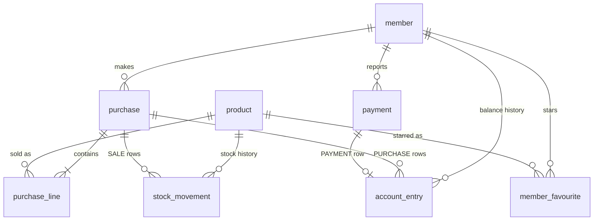

# RevKassa — database model

PostgreSQL 16. Schema is owned by Flyway (`src/main/resources/db/migration`); Hibernate
runs with `ddl-auto=validate`. This document is the design; the first migration
(`V1__init.sql`) will implement it as written here.

Conventions
- Table names singular, `snake_case`. Primary keys `id bigint generated always as identity`.
- Money: `*_cents bigint`, euro cents. Quantities: `integer`, in units (bottles/cans).
- Timestamps: `timestamptz`, default `now()`.
- Enums are `text` with a `CHECK` constraint (mapped with `@Enumerated(EnumType.STRING)`).
- Ledgers (`account_entry`, `stock_movement`) are append-only: never updated or deleted.

## Tables

### member
| column | type | notes |
|---|---|---|
| id | bigint PK | |
| email | text | unique on `lower(email)`; required for `ADMIN` |
| display_name | text not null | shown after login |
| pin_hmac | text not null | unique; HMAC-SHA256(server secret, 6-digit PIN), hex |
| password_hash | text | bcrypt; admin login only, required for `ADMIN` |
| role | text not null | `MEMBER` \| `ADMIN` |
| balance_cents | bigint not null default 0 | cache of `sum(account_entry.amount_cents)`; negative = owes |
| active | boolean not null default true | inactive members can't log in |
| pin_changed_at | timestamptz | |
| created_at | timestamptz not null | |
| version | bigint not null default 0 | optimistic locking |

### product
| column | type | notes |
|---|---|---|
| id | bigint PK | |
| name | text not null | e.g. "Saku Originaal" |
| style | text | e.g. "Lager", optional |
| volume_ml | integer | e.g. 500 |
| price_cents | bigint not null | current selling price, > 0 |
| stock_qty | integer not null default 0 | cache of `sum(stock_movement.quantity_delta)`; may go negative |
| low_stock_threshold | integer not null default 6 | dashboard warning level |
| sort_order | integer not null default 0 | order on the buy screen |
| active | boolean not null default true | hidden from the buy screen when false |
| created_at, updated_at | timestamptz not null | |
| version | bigint not null default 0 | optimistic locking |

### purchase
| column | type | notes |
|---|---|---|
| id | bigint PK | |
| member_id | bigint not null FK member | |
| total_cents | bigint not null | sum of lines, > 0 |
| status | text not null | `COMPLETED` \| `REVERSED` |
| created_at | timestamptz not null | |
| reversed_at | timestamptz | set when reversed |
| reversed_by | bigint FK member | member themselves or an admin |

### purchase_line
| column | type | notes |
|---|---|---|
| id | bigint PK | |
| purchase_id | bigint not null FK purchase | |
| product_id | bigint not null FK product | |
| quantity | integer not null | > 0 |
| unit_price_cents | bigint not null | price at time of sale |

### payment
| column | type | notes |
|---|---|---|
| id | bigint PK | |
| member_id | bigint not null FK member | who paid |
| amount_cents | bigint not null | > 0 |
| method | text not null | `CARD` \| `BANK_TRANSFER` |
| reference | text | bank reference / note from member |
| status | text not null | `PENDING` \| `CONFIRMED` \| `REJECTED` |
| reported_at | timestamptz not null | |
| decided_by | bigint FK member | admin |
| decided_at | timestamptz | |
| decision_note | text | e.g. reason for rejection |

### member_favourite
| column | type | notes |
|---|---|---|
| member_id | bigint not null FK member | PK part 1 |
| product_id | bigint not null FK product | PK part 2 |
| position | integer not null | order on the member's buy screen, 0-based; unique per member |
| created_at | timestamptz not null | |

Primary key `(member_id, product_id)`. Saving replaces the member's whole list in one
transaction (delete + insert), so positions stay 0..n−1. Inactive products are kept but not
shown. `ON DELETE CASCADE` from member is fine here — this is a preference, not a ledger.

### account_entry (money ledger)
| column | type | notes |
|---|---|---|
| id | bigint PK | |
| member_id | bigint not null FK member | |
| type | text not null | `PURCHASE` \| `PURCHASE_REVERSAL` \| `PAYMENT` \| `ADJUSTMENT` |
| amount_cents | bigint not null | signed, ≠ 0: purchase negative, payment positive |
| purchase_id | bigint FK purchase | for `PURCHASE*` |
| payment_id | bigint FK payment | for `PAYMENT`, unique |
| note | text | required for `ADJUSTMENT` |
| created_by | bigint not null FK member | |
| created_at | timestamptz not null | |

### stock_movement (stock ledger)
| column | type | notes |
|---|---|---|
| id | bigint PK | |
| product_id | bigint not null FK product | |
| type | text not null | `DELIVERY` \| `SALE` \| `SALE_REVERSAL` \| `STOCKTAKE` \| `WRITE_OFF` |
| quantity_delta | integer not null | signed, ≠ 0: delivery positive, sale negative |
| unit_cost_cents | bigint | purchase cost, for `DELIVERY` (margin reports) |
| purchase_id | bigint FK purchase | for `SALE*` |
| note | text | |
| created_by | bigint not null FK member | |
| created_at | timestamptz not null | |

## Indexes
- `member (lower(email))` unique (where email is not null)
- `member (pin_hmac)` unique — login lookup
- `purchase (member_id, created_at desc)`
- `payment (status, reported_at)` — admin "pending" list
- `account_entry (member_id, created_at desc)` — member history
- `stock_movement (product_id, created_at desc)`
- `member_favourite (member_id, position)` unique

## Constraints
- `check (role <> 'ADMIN' or (email is not null and password_hash is not null))`
- No limit on `balance_cents`: positive = prepaid credit, negative = open tab.

## Invariants (checked in tests)
- `member.balance_cents = sum(account_entry.amount_cents)` per member.
- `product.stock_qty = sum(stock_movement.quantity_delta)` per product.
- A `COMPLETED` purchase has one `PURCHASE` entry of `-total_cents` and one `SALE` movement
  per line; a `REVERSED` one also has the matching `*_REVERSAL` rows.
- A payment has an `account_entry` iff its status is `CONFIRMED`.

## What one purchase writes (single transaction)
Member buys 2 × Saku (€2.50) + 1 × A. Le Coq (€3.00):
1. `purchase` (total 800, `COMPLETED`) and two `purchase_line` rows.
2. `account_entry` `PURCHASE` −800; `member.balance_cents -= 800`.
3. `stock_movement` `SALE` −2 and −1; `product.stock_qty` updated.
