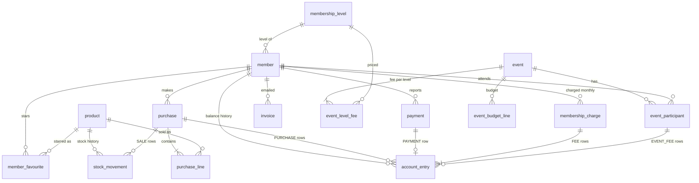

# RevKassa — andmemudel

PostgreSQL 16. See dokument on skeemi kavand. Skeem ise on SQL failides kaustas `docs/database/`:

- `1_reset_database.sql` — kustutab ja loob uuesti `public` skeemi (ainult arenduses!)
- `2_create.sql` — loob kõik tabelid, piirangud, indeksid ja viis algset liikmetaset
- `3_import.sql` — arenduse näidisandmed (liikmed, tooted, ...)

Skripte käivitatakse käsitsi (IntelliJ Database konsool või `psql`). Hibernate ainult valideerib
(`ddl-auto=validate`). Tootmise andmebaasi muudetakse käsitsi muudatusskriptiga kaustas
`docs/database/muudatused/` (vt skill `muuda-andmebaasi-skeemi`); `2_create.sql` uuendatakse samas
muudatuses, et see kirjeldaks alati kogu praegust skeemi.

Konventsioonid
- Tabelinimed ainsuses, `snake_case`. Primaarvõtmed `id bigint generated always as identity`.
- Raha: `*_cents bigint`, eurosendid. Kogused: `integer`, ühikutes (pudelid/purgid).
- Ajatemplid: `timestamptz`, vaikimisi `now()`.
- Enumid on `text` koos `CHECK` piiranguga (Javas `@Enumerated(EnumType.STRING)`).
- Pearaamatud (`account_entry`, `stock_movement`) on ainult lisatavad: ridu ei muudeta ega kustutata.
- 16 tabelit: 8 põhitabelit, `membership_fee`, `membership_charge`, `invoice` ning ürituste jaoks
  `membership_level`, `event`, `event_level_fee`, `event_participant`, `event_budget_line`.
  Nimed on inglise keeles, kuigi UI on eesti keeles.

`membership_fee` hoiab taseme tasu ajas; tasurida kopeerib taseme ja summa.

## Tabelid

### member
| veerg | tüüp | märkused |
|---|---|---|
| id | bigint PK | |
| email | text | unikaalne `lower(email)` järgi; `ADMIN`-il kohustuslik; arvete jaoks |
| display_name | text not null | näidatakse pärast sisselogimist |
| pin_hmac | text not null | unikaalne; HMAC-SHA256(serveri võti, 6-kohaline PIN), hex |
| password_hash | text | bcrypt; ainult admini sisselogimiseks, `ADMIN`-il kohustuslik |
| role | text not null | `MEMBER` \| `ADMIN` |
| balance_cents | bigint not null default 0 | vahemälu `sum(account_entry.amount_cents)`; negatiivne = võlg |
| active | boolean not null default true | mitteaktiivne liige ei saa sisse logida |
| fee_exempt | boolean not null default false | igakuist tasu ei võeta |
| level_id | bigint not null FK membership_level | liikmetase; määrab kuu- ja ürituse tasud |
| pin_changed_at | timestamptz | |
| created_at | timestamptz not null | |
| version | bigint not null default 0 | optimistlik lukk |

### product
| veerg | tüüp | märkused |
|---|---|---|
| id | bigint PK | |
| name | text not null | nt "Saku Originaal" |
| style | text | nt "Lager", valikuline |
| volume_ml | integer | nt 500 |
| price_cents | bigint not null | praegune müügihind, > 0 |
| stock_qty | integer not null default 0 | vahemälu `sum(stock_movement.quantity_delta)`; võib minna negatiivseks |
| low_stock_threshold | integer not null default 6 | ülevaate hoiatuse piir |
| sort_order | integer not null default 0 | järjekord ostuvaates |
| active | boolean not null default true | peidetud ostuvaatest, kui false |
| created_at, updated_at | timestamptz not null | |
| version | bigint not null default 0 | optimistlik lukk |

### purchase
| veerg | tüüp | märkused |
|---|---|---|
| id | bigint PK | |
| member_id | bigint not null FK member | |
| total_cents | bigint not null | ridade summa, > 0 |
| status | text not null | `COMPLETED` \| `REVERSED` |
| created_at | timestamptz not null | |
| reversed_at | timestamptz | seatakse tagasivõtmisel |
| reversed_by | bigint FK member | liige ise või admin |

### purchase_line
| veerg | tüüp | märkused |
|---|---|---|
| id | bigint PK | |
| purchase_id | bigint not null FK purchase | |
| product_id | bigint not null FK product | |
| quantity | integer not null | > 0 |
| unit_price_cents | bigint not null | hind müügi hetkel |

### payment
| veerg | tüüp | märkused |
|---|---|---|
| id | bigint PK | |
| member_id | bigint not null FK member | kes maksis |
| amount_cents | bigint not null | > 0 |
| method | text not null | `CARD` \| `BANK_TRANSFER` |
| reference | text | panga viide / liikme märkus |
| status | text not null | `PENDING` \| `CONFIRMED` \| `REJECTED` |
| reported_at | timestamptz not null | |
| decided_by | bigint FK member | admin |
| decided_at | timestamptz | |
| decision_note | text | nt tagasilükkamise põhjus |

### member_favourite
| veerg | tüüp | märkused |
|---|---|---|
| member_id | bigint not null FK member | PK osa 1 |
| product_id | bigint not null FK product | PK osa 2 |
| position | integer not null | järjekord liikme ostuvaates, 0-põhine; liikme piires unikaalne |
| created_at | timestamptz not null | |

Primaarvõti `(member_id, product_id)`. Salvestamine asendab liikme kogu nimekirja ühes
transaktsioonis (delete + insert), nii et positsioonid jäävad 0..n−1. Mitteaktiivsed tooted
jäävad alles, aga neid ei näidata. `ON DELETE CASCADE` liikmelt on siin lubatud — see on
eelistus, mitte pearaamat.

### account_entry (rahapearaamat)
| veerg | tüüp | märkused |
|---|---|---|
| id | bigint PK | |
| member_id | bigint not null FK member | |
| type | text not null | `PURCHASE` \| `PURCHASE_REVERSAL` \| `PAYMENT` \| `ADJUSTMENT` \| `MEMBERSHIP_FEE` \| `MEMBERSHIP_FEE_WAIVER` \| `EVENT_FEE` \| `EVENT_FEE_REVERSAL` |
| amount_cents | bigint not null | märgiga, ≠ 0: ost ja tasu negatiivsed, makse ja tühistus positiivsed |
| purchase_id | bigint FK purchase | `PURCHASE*` jaoks |
| payment_id | bigint FK payment | `PAYMENT` jaoks, unikaalne |
| membership_charge_id | bigint FK membership_charge | `MEMBERSHIP_FEE*` jaoks |
| event_participant_id | bigint FK event_participant | `EVENT_FEE*` jaoks |
| note | text | kohustuslik `ADJUSTMENT` ja `MEMBERSHIP_FEE_WAIVER` puhul |
| created_by | bigint FK member | null = kirjutas rakendus ise (kuine tasutöö) |
| created_at | timestamptz not null | |

### stock_movement (laopearaamat)
| veerg | tüüp | märkused |
|---|---|---|
| id | bigint PK | |
| product_id | bigint not null FK product | |
| type | text not null | `DELIVERY` \| `SALE` \| `SALE_REVERSAL` \| `STOCKTAKE` \| `WRITE_OFF` |
| quantity_delta | integer not null | märgiga, ≠ 0: tarne positiivne, müük negatiivne |
| unit_cost_cents | bigint | ostuhind, `DELIVERY` jaoks (marginaali aruanded) |
| purchase_id | bigint FK purchase | `SALE*` jaoks |
| note | text | |
| created_by | bigint not null FK member | |
| created_at | timestamptz not null | |

### membership_fee
| veerg | tüüp | märkused |
|---|---|---|
| id | bigint PK | |
| level_id | bigint not null FK membership_level | |
| amount_cents | bigint not null | ≥ 0; 0 = sellelt tasemelt tasu ei võeta |
| valid_from | date not null | kuu esimene päev |
| created_by | bigint not null FK member | admin |
| created_at | timestamptz not null | |

Unikaalne `(level_id, valid_from)`. Taseme tasu kuu jaoks on tema rida, mille `valid_from` on
hiliseim ≤ see kuu; rea puudumine = 0. Ridu ainult lisatakse, ei muudeta, nii et ajalugu jääb
nähtavaks. `2_create.sql` tasusid ei loo (adminid määravad).

### membership_charge
| veerg | tüüp | märkused |
|---|---|---|
| id | bigint PK | |
| member_id | bigint not null FK member | |
| month | date not null | tasustatud kuu esimene päev |
| level_id | bigint not null FK membership_level | liikme tase tasu võtmisel |
| amount_cents | bigint not null | > 0, kopeeritud selle taseme `membership_fee`-st |
| status | text not null | `CHARGED` \| `WAIVED` |
| created_at | timestamptz not null | |
| waived_by | bigint FK member | admin |
| waived_at | timestamptz | |
| waive_note | text | kohustuslik, kui `WAIVED` |

Unikaalne `(member_id, month)` — liikmelt ei saa kunagi ühe kuu eest kaks korda tasu võtta.
Kui tasu on 0, rida ei kirjutata.

### invoice
| veerg | tüüp | märkused |
|---|---|---|
| id | bigint PK | |
| number | text not null | unikaalne, `YYYY-NNNN` aasta kaupa; ka makse selgitus |
| member_id | bigint not null FK member | |
| email_to | text not null | kasutatud aadress, kopeeritud liikmelt |
| amount_cents | bigint not null | > 0, võlg saatmise hetkel (`-balance_cents`) |
| due_date | date not null | |
| status | text not null | `SENT` \| `FAILED` |
| error | text | SMTP viga, kui `FAILED` |
| sent_by | bigint not null FK member | admin |
| created_at | timestamptz not null | |
| sent_at | timestamptz | viimane õnnestunud saatmine |

Arve on maksenõude kirje; see ei muuda kunagi saldot.

### membership_level
| veerg | tüüp | märkused |
|---|---|---|
| id | bigint PK | |
| name | text not null | unikaalne `lower(name)` järgi, nt "Täisliige" |
| sort_order | integer not null | järjekord nimekirjades ja tasutabelites |
| active | boolean not null default true | kasutusest maha võetud tasemel jäävad liikmed alles, aga seda ei pakuta |
| created_at | timestamptz not null | |

`2_create.sql` loob viis taset: Täisliige, Noorliige, Vilistlane, Toetajaliige, Auliige
(ümbernimetatavad). Taset, millele viitab liige või osaleja, ei saa kustutada, ainult kasutusest maha võtta.

### event
| veerg | tüüp | märkused |
|---|---|---|
| id | bigint PK | |
| name | text not null | nt "Jõulupidu 2026" |
| starts_at | timestamptz not null | |
| location | text | |
| description | text | |
| status | text not null | `PLANNED` \| `CLOSED` \| `CANCELLED` |
| signup_open | boolean not null default false | liikmed saavad registreeruda, kui `PLANNED` ja avatud |
| created_by | bigint not null FK member | admin |
| created_at, updated_at | timestamptz not null | |
| version | bigint not null default 0 | optimistlik lukk |

### event_level_fee
| veerg | tüüp | märkused |
|---|---|---|
| event_id | bigint not null FK event | PK osa 1, `ON DELETE CASCADE` |
| level_id | bigint not null FK membership_level | PK osa 2 |
| amount_cents | bigint not null | ≥ 0 |

Kui tasemel rida pole, on tema tasu sellel üritusel 0.

### event_participant
| veerg | tüüp | märkused |
|---|---|---|
| id | bigint PK | |
| event_id | bigint not null FK event | |
| member_id | bigint not null FK member | |
| level_id | bigint not null FK membership_level | kopeeritakse lisamisel |
| fee_cents | bigint not null | ≥ 0, kopeeritakse lisamisel `event_level_fee`-st |
| status | text not null | `ACTIVE` \| `REMOVED` |
| added_by | bigint not null FK member | admin või liige ise (= iseregistreerimine) |
| added_at | timestamptz not null | |
| removed_at | timestamptz | |

Unikaalne `(event_id, member_id)`: eemaldatud liikme uuesti lisamine teeb rea taas `ACTIVE`-iks
praeguse taseme ja tasuga ning kirjutab uue `EVENT_FEE` rea.

### event_budget_line
| veerg | tüüp | märkused |
|---|---|---|
| id | bigint PK | |
| event_id | bigint not null FK event | `ON DELETE CASCADE` (planeerimisandmed, mitte pearaamat) |
| category | text not null | `DRINKS` \| `SNACKS` \| `FOOD` \| `ENTERTAINMENT` \| `VENUE` \| `DECORATION` \| `OTHER` |
| description | text not null | nt "Saku Originaal, 3 kasti" |
| planned_cents | bigint not null | ≥ 0 |
| actual_cents | bigint | ≥ 0, täidetakse pärast ostmist |
| note | text | |
| source | text not null default 'MANUAL' | `MANUAL` \| `AI` (vastu võetud abilise ettepanek) |
| sort_order | integer not null default 0 | |
| created_by | bigint not null FK member | |
| created_at, updated_at | timestamptz not null | |

## Indeksid
- `member (lower(email))` unikaalne (kus email ei ole null)
- `member (pin_hmac)` unikaalne — sisselogimise otsing
- `purchase (member_id, created_at desc)`
- `payment (status, reported_at)` — admini "ootel" nimekiri
- `account_entry (member_id, created_at desc)` — liikme ajalugu
- `stock_movement (product_id, created_at desc)`
- `member_favourite (member_id, position)` unikaalne
- `membership_fee (level_id, valid_from)` unikaalne
- `membership_charge (member_id, month)` unikaalne; `membership_charge (month)`
- `invoice (number)` unikaalne; `invoice (member_id, created_at desc)`
- `membership_level (lower(name))` unikaalne
- `event (starts_at desc)`
- `event_participant (event_id, member_id)` unikaalne; `event_participant (member_id)`
- `event_budget_line (event_id, category)`

## Piirangud
- `check (role <> 'ADMIN' or (email is not null and password_hash is not null))`
- `balance_cents` piirangut pole: positiivne = ettemaks, negatiivne = võlg.

## Invariandid (kontrollitakse testides)
- `member.balance_cents = sum(account_entry.amount_cents)` liikme kohta.
- `product.stock_qty = sum(stock_movement.quantity_delta)` toote kohta.
- `COMPLETED` ostul on üks `PURCHASE` rida summaga `-total_cents` ja üks `SALE` liikumine rea
  kohta; `REVERSED` ostul on lisaks vastavad `*_REVERSAL` read.
- Maksel on `account_entry` rida siis ja ainult siis, kui staatus on `CONFIRMED`.
- `CHARGED` liikmemaksul on üks `MEMBERSHIP_FEE` rida summaga `-amount_cents`; `WAIVED`
  tasul on lisaks üks `MEMBERSHIP_FEE_WAIVER` rida summaga `+amount_cents`.
- `event_participant` kohta on tema ridade summa `-fee_cents`, kui `ACTIVE`, ja 0, kui
  `REMOVED` (tasu 0 korral ridu üldse pole). `CANCELLED` üritusel pole `ACTIVE` osalejaid.

## Mida üks ost kirjutab (üks transaktsioon)
Liige ostab 2 × Saku (2,50 €) + 1 × A. Le Coq (3,00 €):
1. `purchase` (summa 800, `COMPLETED`) ja kaks `purchase_line` rida.
2. `account_entry` `PURCHASE` −800; `member.balance_cents -= 800`.
3. `stock_movement` `SALE` −2 ja −1; `product.stock_qty` uuendatakse.
