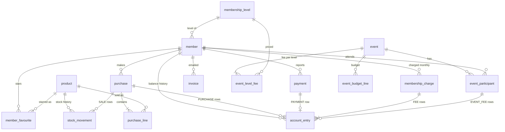

# RevKassa — database model

PostgreSQL 16. Schema is owned by Flyway (`src/main/resources/db/migration`); Hibernate
runs with `ddl-auto=validate`. This document is the design; the first migration
(`V1__init.sql`) will implement it as written here.

Conventions
- Table names singular, `snake_case`. Primary keys `id bigint generated always as identity`.
- Money: `*_cents bigint`, euro cents. Quantities: `integer`, in units (bottles/cans).
- Timestamps: `timestamptz`, default `now()`.
- Enums are `text` with a `CHECK` constraint (mapped with `@Enumerated(EnumType.STRING)`).
- Ledgers (`account_entry`, `stock_movement`) are append-only: never updated or deleted.
- 16 tables: the 8 core ones, `membership_fee`, `membership_charge`, `invoice`, and for
  events `membership_level`, `event`, `event_level_fee`, `event_participant`,
  `event_budget_line`. Names stay English even though the UI is Estonian.

`membership_fee` holds the fee per level over time; a charge copies the level and amount.

## Tables

### member
| column | type | notes |
|---|---|---|
| id | bigint PK | |
| email | text | unique on `lower(email)`; required for `ADMIN`; used for invoices |
| display_name | text not null | shown after login |
| pin_hmac | text not null | unique; HMAC-SHA256(server secret, 6-digit PIN), hex |
| password_hash | text | bcrypt; admin login only, required for `ADMIN` |
| role | text not null | `MEMBER` \| `ADMIN` |
| balance_cents | bigint not null default 0 | cache of `sum(account_entry.amount_cents)`; negative = owes |
| active | boolean not null default true | inactive members can't log in |
| fee_exempt | boolean not null default false | not charged the monthly fee |
| level_id | bigint not null FK membership_level | membership level; drives monthly and event fees |
| pin_changed_at | timestamptz | |
| created_at | timestamptz not null | |
| version | bigint not null default 0 | optimistic locking |

### product
| column | type | notes |
|---|---|---|
| id | bigint PK | |
| name | text not null | e.g. "Saku Originaal" |
| style | text | e.g. "Lager", optional |
| volume_ml | integer | e.g. 500 |
| price_cents | bigint not null | current selling price, > 0 |
| stock_qty | integer not null default 0 | cache of `sum(stock_movement.quantity_delta)`; may go negative |
| low_stock_threshold | integer not null default 6 | dashboard warning level |
| sort_order | integer not null default 0 | order on the buy screen |
| active | boolean not null default true | hidden from the buy screen when false |
| created_at, updated_at | timestamptz not null | |
| version | bigint not null default 0 | optimistic locking |

### purchase
| column | type | notes |
|---|---|---|
| id | bigint PK | |
| member_id | bigint not null FK member | |
| total_cents | bigint not null | sum of lines, > 0 |
| status | text not null | `COMPLETED` \| `REVERSED` |
| created_at | timestamptz not null | |
| reversed_at | timestamptz | set when reversed |
| reversed_by | bigint FK member | member themselves or an admin |

### purchase_line
| column | type | notes |
|---|---|---|
| id | bigint PK | |
| purchase_id | bigint not null FK purchase | |
| product_id | bigint not null FK product | |
| quantity | integer not null | > 0 |
| unit_price_cents | bigint not null | price at time of sale |

### payment
| column | type | notes |
|---|---|---|
| id | bigint PK | |
| member_id | bigint not null FK member | who paid |
| amount_cents | bigint not null | > 0 |
| method | text not null | `CARD` \| `BANK_TRANSFER` |
| reference | text | bank reference / note from member |
| status | text not null | `PENDING` \| `CONFIRMED` \| `REJECTED` |
| reported_at | timestamptz not null | |
| decided_by | bigint FK member | admin |
| decided_at | timestamptz | |
| decision_note | text | e.g. reason for rejection |

### member_favourite
| column | type | notes |
|---|---|---|
| member_id | bigint not null FK member | PK part 1 |
| product_id | bigint not null FK product | PK part 2 |
| position | integer not null | order on the member's buy screen, 0-based; unique per member |
| created_at | timestamptz not null | |

Primary key `(member_id, product_id)`. Saving replaces the member's whole list in one
transaction (delete + insert), so positions stay 0..n−1. Inactive products are kept but not
shown. `ON DELETE CASCADE` from member is fine here — this is a preference, not a ledger.

### account_entry (money ledger)
| column | type | notes |
|---|---|---|
| id | bigint PK | |
| member_id | bigint not null FK member | |
| type | text not null | `PURCHASE` \| `PURCHASE_REVERSAL` \| `PAYMENT` \| `ADJUSTMENT` \| `MEMBERSHIP_FEE` \| `MEMBERSHIP_FEE_WAIVER` \| `EVENT_FEE` \| `EVENT_FEE_REVERSAL` |
| amount_cents | bigint not null | signed, ≠ 0: purchase and fee negative, payment and waiver positive |
| purchase_id | bigint FK purchase | for `PURCHASE*` |
| payment_id | bigint FK payment | for `PAYMENT`, unique |
| membership_charge_id | bigint FK membership_charge | for `MEMBERSHIP_FEE*` |
| event_participant_id | bigint FK event_participant | for `EVENT_FEE*` |
| note | text | required for `ADJUSTMENT` and `MEMBERSHIP_FEE_WAIVER` |
| created_by | bigint FK member | null = written by the app itself (monthly fee job) |
| created_at | timestamptz not null | |

### stock_movement (stock ledger)
| column | type | notes |
|---|---|---|
| id | bigint PK | |
| product_id | bigint not null FK product | |
| type | text not null | `DELIVERY` \| `SALE` \| `SALE_REVERSAL` \| `STOCKTAKE` \| `WRITE_OFF` |
| quantity_delta | integer not null | signed, ≠ 0: delivery positive, sale negative |
| unit_cost_cents | bigint | purchase cost, for `DELIVERY` (margin reports) |
| purchase_id | bigint FK purchase | for `SALE*` |
| note | text | |
| created_by | bigint not null FK member | |
| created_at | timestamptz not null | |

### membership_fee
| column | type | notes |
|---|---|---|
| id | bigint PK | |
| level_id | bigint not null FK membership_level | |
| amount_cents | bigint not null | ≥ 0; 0 = this level isn't charged |
| valid_from | date not null | first day of a month |
| created_by | bigint not null FK member | admin |
| created_at | timestamptz not null | |

Unique `(level_id, valid_from)`. A level's fee for a month is its row with the latest
`valid_from` ≤ that month; no row = 0. Rows are only added, never edited, so the history stays
visible. V1 seeds no fees (admins set them).

### membership_charge
| column | type | notes |
|---|---|---|
| id | bigint PK | |
| member_id | bigint not null FK member | |
| month | date not null | first day of the charged month |
| level_id | bigint not null FK membership_level | member's level when charged |
| amount_cents | bigint not null | > 0, copied from that level's `membership_fee` |
| status | text not null | `CHARGED` \| `WAIVED` |
| created_at | timestamptz not null | |
| waived_by | bigint FK member | admin |
| waived_at | timestamptz | |
| waive_note | text | required when `WAIVED` |

Unique `(member_id, month)` — a member can never be charged twice for a month. No row is
written when the fee is 0.

### invoice
| column | type | notes |
|---|---|---|
| id | bigint PK | |
| number | text not null | unique, `YYYY-NNNN` counting per year; also the payment reference |
| member_id | bigint not null FK member | |
| email_to | text not null | address used, copied from the member |
| amount_cents | bigint not null | > 0, amount owed when sent (`-balance_cents`) |
| due_date | date not null | |
| status | text not null | `SENT` \| `FAILED` |
| error | text | SMTP error when `FAILED` |
| sent_by | bigint not null FK member | admin |
| created_at | timestamptz not null | |
| sent_at | timestamptz | last successful send |

An invoice is a record of a payment request; it never changes the balance.

### membership_level
| column | type | notes |
|---|---|---|
| id | bigint PK | |
| name | text not null | unique on `lower(name)`, e.g. "Täisliige" |
| sort_order | integer not null | order in lists and fee tables |
| active | boolean not null default true | retired levels keep their members but aren't offered |
| created_at | timestamptz not null | |

V1 seeds five levels: Täisliige, Noorliige, Vilistlane, Toetajaliige, Auliige (renamable).
A level referenced by a member or participant can't be deleted, only retired.

### event
| column | type | notes |
|---|---|---|
| id | bigint PK | |
| name | text not null | e.g. "Jõulupidu 2026" |
| starts_at | timestamptz not null | |
| location | text | |
| description | text | |
| status | text not null | `PLANNED` \| `CLOSED` \| `CANCELLED` |
| signup_open | boolean not null default false | members can sign up while `PLANNED` and open |
| created_by | bigint not null FK member | admin |
| created_at, updated_at | timestamptz not null | |
| version | bigint not null default 0 | optimistic locking |

### event_level_fee
| column | type | notes |
|---|---|---|
| event_id | bigint not null FK event | PK part 1, `ON DELETE CASCADE` |
| level_id | bigint not null FK membership_level | PK part 2 |
| amount_cents | bigint not null | ≥ 0 |

A level without a row means fee 0 for that event.

### event_participant
| column | type | notes |
|---|---|---|
| id | bigint PK | |
| event_id | bigint not null FK event | |
| member_id | bigint not null FK member | |
| level_id | bigint not null FK membership_level | copied when added |
| fee_cents | bigint not null | ≥ 0, copied from `event_level_fee` when added |
| status | text not null | `ACTIVE` \| `REMOVED` |
| added_by | bigint not null FK member | admin, or the member themselves (= self sign-up) |
| added_at | timestamptz not null | |
| removed_at | timestamptz | |

Unique `(event_id, member_id)`: re-adding a removed member sets the row `ACTIVE` again with
the current level and fee, and writes a new `EVENT_FEE` entry.

### event_budget_line
| column | type | notes |
|---|---|---|
| id | bigint PK | |
| event_id | bigint not null FK event | `ON DELETE CASCADE` (planning data, not a ledger) |
| category | text not null | `DRINKS` \| `SNACKS` \| `FOOD` \| `ENTERTAINMENT` \| `VENUE` \| `DECORATION` \| `OTHER` |
| description | text not null | e.g. "Saku Originaal, 3 kasti" |
| planned_cents | bigint not null | ≥ 0 |
| actual_cents | bigint | ≥ 0, filled in after buying |
| note | text | |
| source | text not null default 'MANUAL' | `MANUAL` \| `AI` (accepted assistant suggestion) |
| sort_order | integer not null default 0 | |
| created_by | bigint not null FK member | |
| created_at, updated_at | timestamptz not null | |

## Indexes
- `member (lower(email))` unique (where email is not null)
- `member (pin_hmac)` unique — login lookup
- `purchase (member_id, created_at desc)`
- `payment (status, reported_at)` — admin "pending" list
- `account_entry (member_id, created_at desc)` — member history
- `stock_movement (product_id, created_at desc)`
- `member_favourite (member_id, position)` unique
- `membership_fee (level_id, valid_from)` unique
- `membership_charge (member_id, month)` unique; `membership_charge (month)`
- `invoice (number)` unique; `invoice (member_id, created_at desc)`
- `membership_level (lower(name))` unique
- `event (starts_at desc)`
- `event_participant (event_id, member_id)` unique; `event_participant (member_id)`
- `event_budget_line (event_id, category)`

## Constraints
- `check (role <> 'ADMIN' or (email is not null and password_hash is not null))`
- No limit on `balance_cents`: positive = prepaid credit, negative = open tab.

## Invariants (checked in tests)
- `member.balance_cents = sum(account_entry.amount_cents)` per member.
- `product.stock_qty = sum(stock_movement.quantity_delta)` per product.
- A `COMPLETED` purchase has one `PURCHASE` entry of `-total_cents` and one `SALE` movement
  per line; a `REVERSED` one also has the matching `*_REVERSAL` rows.
- A payment has an `account_entry` iff its status is `CONFIRMED`.
- A `CHARGED` membership charge has one `MEMBERSHIP_FEE` entry of `-amount_cents`; a `WAIVED`
  one also has one `MEMBERSHIP_FEE_WAIVER` entry of `+amount_cents`.
- Per `event_participant`, the sum of its entries is `-fee_cents` when `ACTIVE` and 0 when
  `REMOVED` (no entries at all when the fee is 0). A `CANCELLED` event has no `ACTIVE`
  participants.

## What one purchase writes (single transaction)
Member buys 2 × Saku (€2.50) + 1 × A. Le Coq (€3.00):
1. `purchase` (total 800, `COMPLETED`) and two `purchase_line` rows.
2. `account_entry` `PURCHASE` −800; `member.balance_cents -= 800`.
3. `stock_movement` `SALE` −2 and −1; `product.stock_qty` updated.
